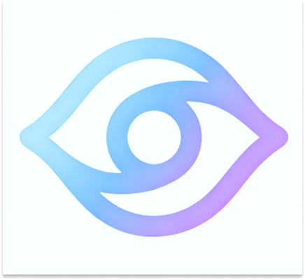
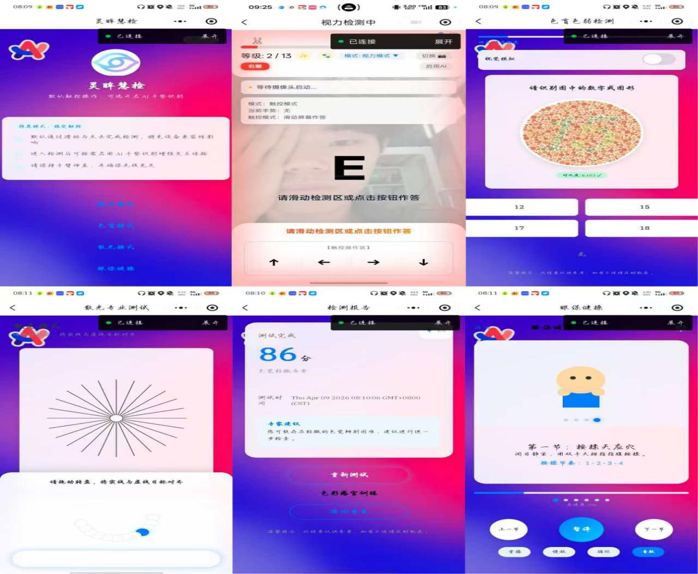
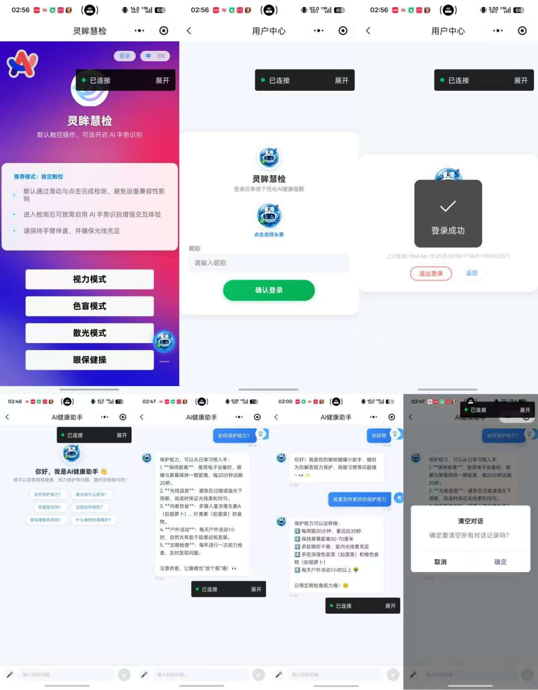
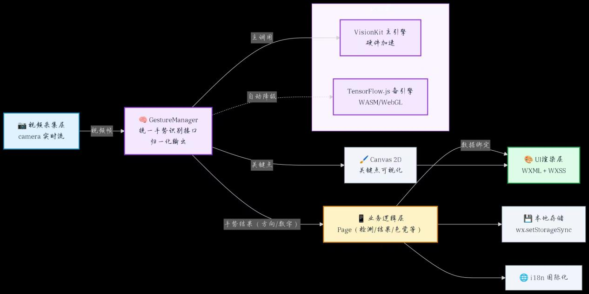
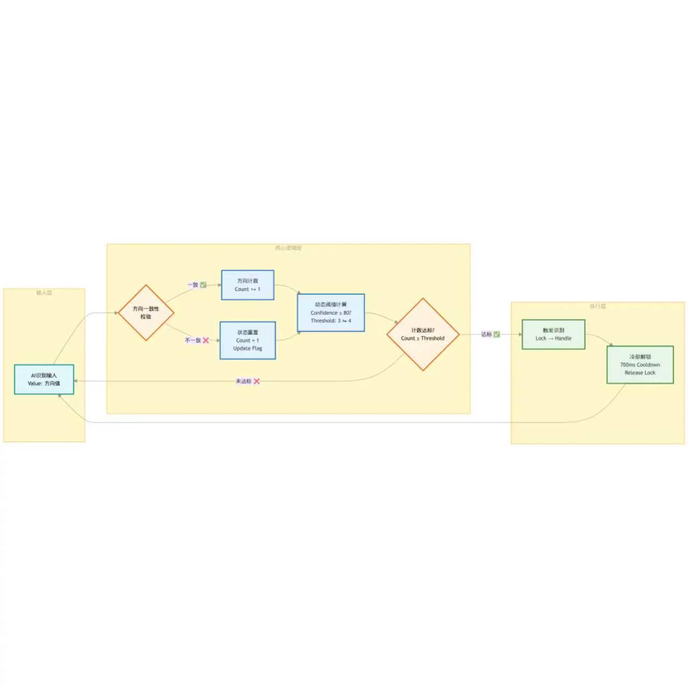
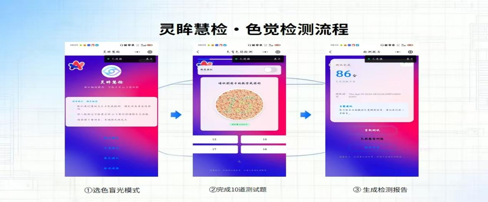
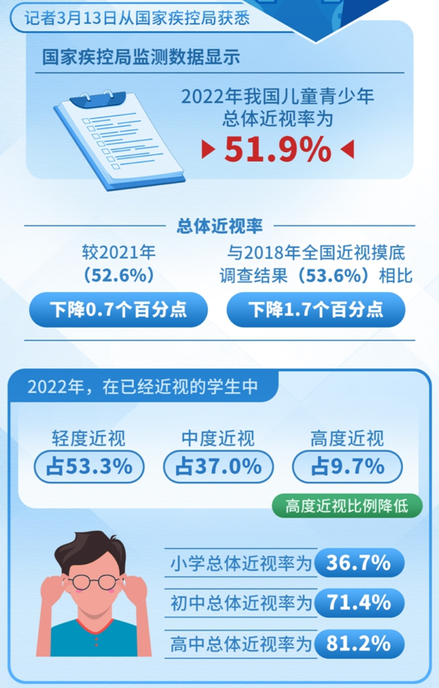
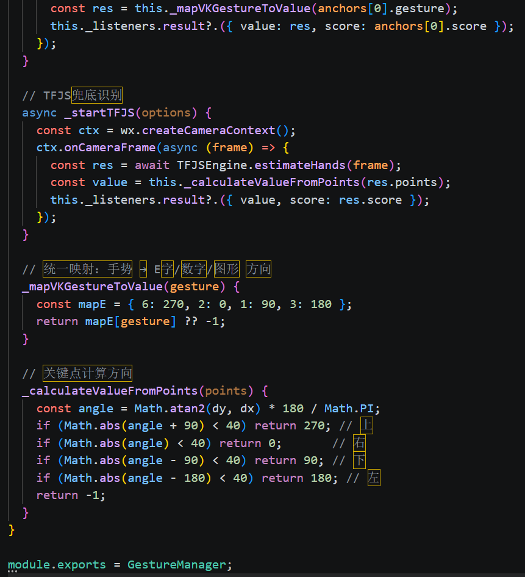

# 灵眸慧检（AI Vision Test）· 眼健康检测与护眼训练微信小程序



一站式**眼健康检测与护眼训练**小程序（中国大学生计算机设计大赛参赛作品）：把 **视力检测、色觉检测、散光初筛与训练、护眼训练、眼保健操、AI 健康助手**装进手机，面向儿童青少年近视防控场景（背景数据：2022 年我国儿童青少年总体近视率 51.9%）。

## 功能总览

| 模块 | 功能 |
|---|---|
| 视力检测 | 13 级 E 字/数字/图形视力表（4.0–5.2），支持**手势作答**或触控作答，左/右眼切换 |
| 检测报告 | 视力/色觉/散光三种检测共用的结果页（等级分析 + 护眼引导） |
| 色觉检测 | 7 张石原氏图（5/1/36/6/骆驼/猎豹/铃鹿）+ 5 种色觉模拟 + WCAG 对比度显示 |
| 散光 | 12 线散光表初筛；经线对齐 + Gabor 对比度训练，连续天数统计 |
| 护眼训练 | 追星星/气球/风车 3 个 60 秒小游戏 + 周训练统计 |
| 色彩训练 | 色差挑战/色彩记忆/渐变排序（色盲友好配色） |
| 眼保健操 | 6 节图解轮播 |
| AI 健康助手 | DeepSeek 流式对话（文字/语音提问 + TTS 朗读），悬浮球全局入口 |
| 其他 | 中英双语（自研 i18n）、本地登录（无后端）、粒子动画首页 |

## 截图










## 技术亮点

- **手势答题**：VisionKit（`wx.createVKSession` 手部关键点）为主引擎 + **TensorFlow.js handpose 自动降级**双引擎（`utils/GestureManager.js`）；基于 21 关键点的**手指方向角（E 字模式）/ 指伸展计数（数字模式）**映射答案，方向需连续 2–4 帧一致才确认（带置信度自适应阈值与冷却锁）；
- **流式中文解码**：手写 UTF-8 状态机解码器，解决 SSE 流式分块把 3 字节中文/4 字节 emoji 拆断导致的乱码（`utils/deepseek-api.js`）；
- **色觉工程**：protanopia/deuteranopia/tritanopia/achromatopsia 模拟矩阵 + WCAG 对比度计算（`utils/color-simulation.js`）。

## ⚠️ 手势识别现状（欢迎完善）

**手势识别功能尚不完善**：受设备兼容性与性能限制——VisionKit 在部分机型不可用，TF.js 降级路径对中低端手机性能吃紧，图形模式目前仅完整支持圆形识别。**如果有能力，欢迎你把它完善（PR）**。

## 快速开始

1. **导入**：微信开发者工具 → 导入项目 → 选择本目录；基础库选 **3.15.1**；
2. **开箱即用**：触控作答、色觉/散光检测、训练游戏与全部 UI 无需构建即可运行；
3. **启用手势识别**（可选，需 Node 环境）：
   ```bash
   npm install @tensorflow/tfjs-core @tensorflow/tfjs-backend-webgl @tensorflow/tfjs-wechat @tensorflow-models/handpose fetch-wechat
   ```
   然后开发者工具 → 工具 → **构建 npm**；
4. **启用 AI 聊天**（可选）：在 `utils/config.js` 填入你自己的 DeepSeek API Key（仓库中为占位符 `sk-REPLACE_WITH_YOUR_OWN_DEEPSEEK_KEY`）。

## 目录结构

```
├── app.js / app.json / app.wxss   # 入口（i18n 初始化、全局样式）
├── utils/                         # 核心工具层（config / deepseek-api / GestureManager / tfjs-engine / color-simulation / i18n / tts）
├── components/                    # float-ball（悬浮球 AI）/ vision-chart（视力表）/ greeting-dialog
├── pages/                         # 主包：index / detect / result / protect / astigmatism(-train) / color-train
├── package_colorblind/            # 分包：石原氏色觉检测
├── package_ai/                    # 分包：AI 聊天
├── package_user/                  # 分包：本地登录
├── package_eye_exercises/         # 分包：眼保健操
├── docs/screenshots/              # 展示截图（已剔除任何真人照片）
├── learn.md / study.md            # 项目学习/重构笔记
└── MediaPipe_Migration_Guide.md   # 手势引擎兼容性评估与迁移指南
```

## 隐私说明

- 本仓库**不包含任何真人照片素材**：展示截图经过逐张筛查，剔除了全部含真人面孔/人眼照片的图片；
- 全项目数据均为本机存储（无后端、无云开发）；DeepSeek 密钥占位符需使用者自备。

---
本仓库为参赛作品存档，供学习与交流。
